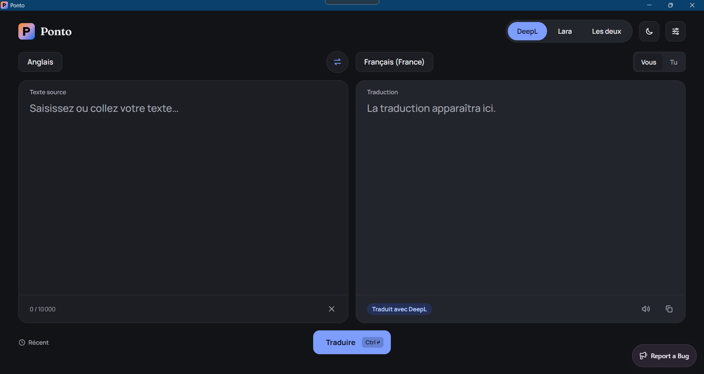
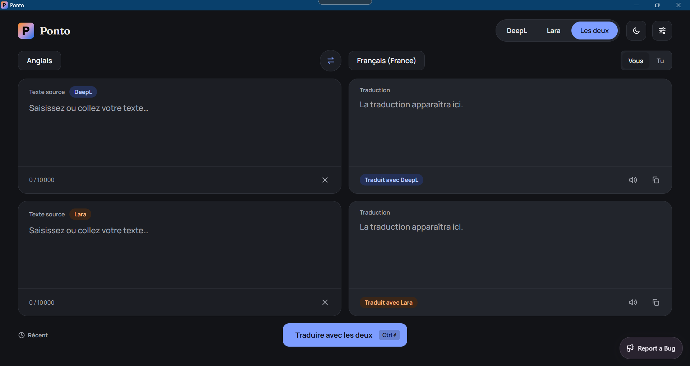
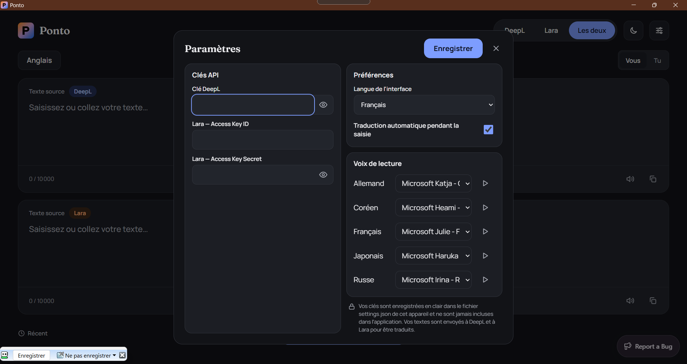

  

# Ponto

🇫🇷 [Français](#français) · 🇬🇧 [English](#english)

---

## Français

Application de traduction multilingue développée avec Tauri 2, utilisant les moteurs DeepL et Lara.

### Présentation

L'application Ponto s'appuie sur deux moteurs de traduction : **DeepL** et **Lara**. Vous pouvez choisir l'un ou l'autre ou comparer les deux en les utilisant en parallèle.

### Clés API

Pour utiliser l'application, vous aurez besoin d'une clé API et donc aussi d'un compte pour le ou les moteurs que vous souhaitez utiliser.

- DeepL :
  - Création d'un compte : <https://auth.deepl.com/signup>
  - Connexion : <https://auth.deepl.com/login>
  - Tarifs de l'API : <https://www.deepl.com/en/pro#api>

- Lara :
  - Création d'un compte : <https://app.laratranslate.com/sign-up>
  - Connexion : <https://app.laratranslate.com/login>
  - Tarifs : <https://app.laratranslate.com/pricing?billing=monthly>

Une fois connecté à votre compte, créez votre clé API depuis les paramètres du compte.

:warning: :warning: Attention :warning: :warning:

Les clés se saisissent dans les paramètres de l'application et sont stockées localement en clair dans le fichier `settings.json` de l'appareil utilisé (Windows, Linux et Android). Sur le site web, elles sont chiffrées dans le navigateur (voir « Version web »).

### Utilisation

#### Windows et Linux

Le fonctionnement est identique sur les deux systèmes. Sous Linux, l'application est publiée en AppImage, `.deb` et `.rpm` (WebKitGTK 4.1 requis). La lecture à voix haute passe par `speech-dispatcher` (recommandé par les paquets `.deb` et `.rpm`), car WebKitGTK est en général distribué sans synthèse vocale ; sans lui, le bouton d'écoute est masqué. Pour compiler sous Linux, installez aussi `libspeechd-dev` et libclang (`libclang-dev` sous Debian/Ubuntu), dont bindgen a besoin pour générer la liaison avec libspeechd.

Lorsque vous n'utilisez qu'un seul moteur (DeepL ou Lara), il y a deux panneaux, un pour le texte à traduire et l'autre pour la traduction.

  

Lorsque vous utilisez les deux moteurs, il y a quatre panneaux. Deux pour le texte à traduire et deux pour la traduction.

  

Pour Windows il faut installé les langues que vous voulez entendre.

#### Android

Le fonctionnement est identique, avec une différence :

- Avec les deux moteurs, le téléphone est en mode paysage
- Avec un seul moteur, le téléphone est en mode portrait

### Version web

Ponto est aussi disponible comme site web, installable en application (PWA) sur iOS et macOS. Pour Windows, Linux et Android, vous pouvez utiliser l'application native :

<https://github.com/avuillet93TheFrenchy/Ponto/releases/latest>.

- **Utilisation** : ouvrez le site, saisissez vos clés dans les paramètres, puis traduisez comme dans l'application. Vos clés sont chiffrées (AES-GCM) dans le navigateur ; le worker Cloudflare qui relaie les requêtes vers DeepL et Lara ne conserve rien et ses journaux de requêtes sont désactivés. Les clés voyagent dans des en-têtes, jamais dans une URL.
- **Limite du chiffrement** : il protège le stockage au repos, pas contre un script malveillant exécuté sur la même origine. Le bouton « Effacer mes clés » des paramètres supprime les clés et la clé de chiffrement.
- **Clés à ressaisir** : dans l'application installée sur iOS (stockage séparé de Safari) et après un effacement des données du site.
- **Mises à jour** : quand une nouvelle version est publiée, un bandeau « Mise à jour disponible » apparaît ; « Mettre à jour » l'active et recharge la page (pensez à copier un texte en cours avant).
- **Installation** : iOS et iPadOS, Partager › Sur l'écran d'accueil ; Safari sur macOS, Fichier › Ajouter au Dock ; Chrome, Edge ou Chromium, bouton « Installer » du site ou icône dans la barre d'adresse.
- **Déploiement** : `pnpm deploy:web` construit le site et le publie avec Wrangler (un seul Worker sert `dist/` et `/api/*`). Il faut un compte Cloudflare et `wrangler login`. Avec `NODE_ENV=production`, ce que fait `deploy:web`, la compilation envoie aussi les source maps à Sentry (jeton dans `.env.local`). En local : `pnpm dev:web`.

### Settings

Veuilliez remplir la case DeepL et les cases Lara avec les clé API.

  

### Confidentialité

Les textes que vous saisissez sont envoyés à DeepL et/ou à Lara pour être traduits. Leurs conditions d'utilisation et leurs politiques de confidentialité s'appliquent. Évitez de saisir des informations sensibles si ces conditions ne vous conviennent pas.

### Gestion des bugs

L'application utilise [Sentry](https://sentry.io) pour détecter et analyser les bugs rencontrés dans l'application. Lorsqu'une erreur survient, un rapport technique peut être envoyé à Sentry afin d'aider l'auteur à la corriger. La politique de confidentialité de Sentry s'applique.

Vous pouvez aussi signaler un problème en ouvrant une [issue](https://github.com/avuillet93TheFrenchy/Ponto/issues) sur GitHub.

### Licence et contributions

© 2026 Alexandre Vuillet ([avuillet93TheFrenchy](https://github.com/avuillet93TheFrenchy)).

Ce projet est distribué sous licence [Apache 2.0](LICENSE).

Vous pouvez utiliser, modifier et redistribuer ce code, à condition de :

- conserver la licence et les mentions de copyright ;
- indiquer les fichiers que vous avez modifiés ;
- reprendre le contenu du fichier [NOTICE](NOTICE), qui désigne Ponto comme projet initial ;
- ne pas utiliser le nom « Ponto » ni le nom de l'auteur pour promouvoir un dérivé.

Ce projet est maintenu uniquement par son auteur. Les pull requests sont les bienvenues, mais seul l'auteur décide de leur intégration. Toute contribution envoyée au projet est soumise à la licence Apache 2.0.

### Avertissement

Ponto est un projet indépendant. Il n'est affilié ni à DeepL ni à Lara. Ces noms appartiennent à leurs propriétaires respectifs.

---

## English

Multilingual translation app developed with Tauri 2, using the DeepL and Lara translation engines.

### Overview

The Ponto app relies on two translation engines: **DeepL** and **Lara**. You can choose one or the other, or compare the two by using them side by side.

### API Keys

To use the app, you’ll need an API key and, therefore, an account for the engine(s) you wish to use.

- DeepL:
  - Create an account: <https://auth.deepl.com/signup>
  - Sign in: <https://auth.deepl.com/login>
  - API pricing: <https://www.deepl.com/en/pro#api>

- Lara:
  - Create an account: <https://app.laratranslate.com/sign-up>
  - Sign in: <https://app.laratranslate.com/login>
  - Pricing: <https://app.laratranslate.com/pricing?billing=monthly>

Once logged into your account, create your API key in the account settings.

:warning: :warning: Warning :warning: :warning:

Keys are entered in the app settings and are stored locally in plain text in the `settings.json` file on the device being used (Windows, Linux, and Android). On the website, they are encrypted in the browser (see “Web Version”).

### Usage

#### Windows and Linux

The process is the same on both systems. On Linux, the application is available as an AppImage, `.deb`, and `.rpm` (WebKitGTK 4.1 required). Text-to-speech uses `speech-dispatcher` (recommended by the `.deb` and `.rpm` packages), since WebKitGTK is generally distributed without text-to-speech support; without it, the play button is hidden. To compile on Linux, also install `libspeechd-dev` and libclang (`libclang-dev` on Debian/Ubuntu), which bindgen needs to generate the libspeechd bindings.

When using only one engine (DeepL or Lara), there are two panels: one for the text to be translated and the other for the translation.

  

When using both engines, there are four panels: two for the text to be translated and two for the translation.

  

For Windows, you need to install the languages you want to hear.

#### Android

The operation is the same, with one difference:

- With both engines, the phone is in landscape mode
- With only one engine, the phone is in portrait mode

### Web Version

Ponto is also available as a website and can be installed as a Progressive Web App (PWA) on iOS and macOS. For Windows, Linux, and Android, you can use the native app:

<https://github.com/avuillet93TheFrenchy/Ponto/releases/latest>.

- **Usage**: Open the website, enter your keys in the settings, then translate as you would in the app. Your keys are encrypted (AES-GCM) in the browser; the Cloudflare worker that relays requests to DeepL and Lara does not store any data, and its request logs are disabled. Keys are transmitted in headers, never in a URL.
- **Limitations of encryption**: It protects data at rest, but not against a malicious script running on the same origin. The “Clear My Keys” button in the settings deletes the keys and the encryption key.
- **Keys to re-enter**: In the iOS app (stored separately from Safari) and after clearing the site’s data.
- **Updates**: When a new version is released, an “Update Available” banner appears; clicking “Update” activates it and reloads the page (be sure to copy any text you’re working on first).
- **Installation**: iOS and iPadOS, Share › Add to Home Screen; Safari on macOS, File › Add to Dock; Chrome, Edge, or Chromium, the “Install” button on the site or the icon in the address bar.
- **Deployment**: `pnpm deploy:web` builds the site and deploys it using Wrangler (a single Worker serves `dist/` and `/api/*`). You need a Cloudflare account and `wrangler login`. With `NODE_ENV=production`—which is what `deploy:web` does—the build also sends source maps to Sentry (token in `.env.local`). Locally: `pnpm dev:web`.

### Privacy

The text you enter is sent to DeepL and/or Lara for translation. Their terms of service and privacy policies apply. Avoid entering sensitive information if you do not agree with these terms.

### Bug Tracking

The application uses [Sentry](https://sentry.io) to detect and analyze bugs encountered in the application. When an error occurs, a technical report may be sent to Sentry to help the author fix it. Sentry’s privacy policy applies.

You can also report an issue by opening an [issue](https://github.com/avuillet93TheFrenchy/Ponto/issues) on GitHub.

### License and Contributions

© 2026 Alexandre Vuillet ([avuillet93TheFrenchy](https://github.com/avuillet93TheFrenchy)).

This project is distributed under the [Apache 2.0](LICENSE) license.

You may use, modify, and redistribute this code, provided that you:

- retain the license and copyright notices;
- indicate which files you have modified;
- include the contents of the [NOTICE](NOTICE) file, which identifies Ponto as the original project;
- do not use the name “Ponto” or the author’s name to promote a derivative work.

This project is maintained solely by its author. Pull requests are welcome, but only the author decides whether to incorporate them. Any contribution submitted to the project is subject to the Apache 2.0 License.

### Disclaimer

Ponto is an independent project. It is not affiliated with DeepL or Lara. These names belong to their respective owners.
